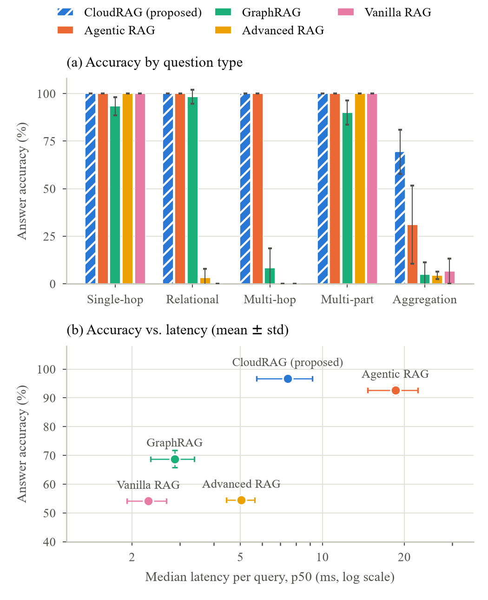
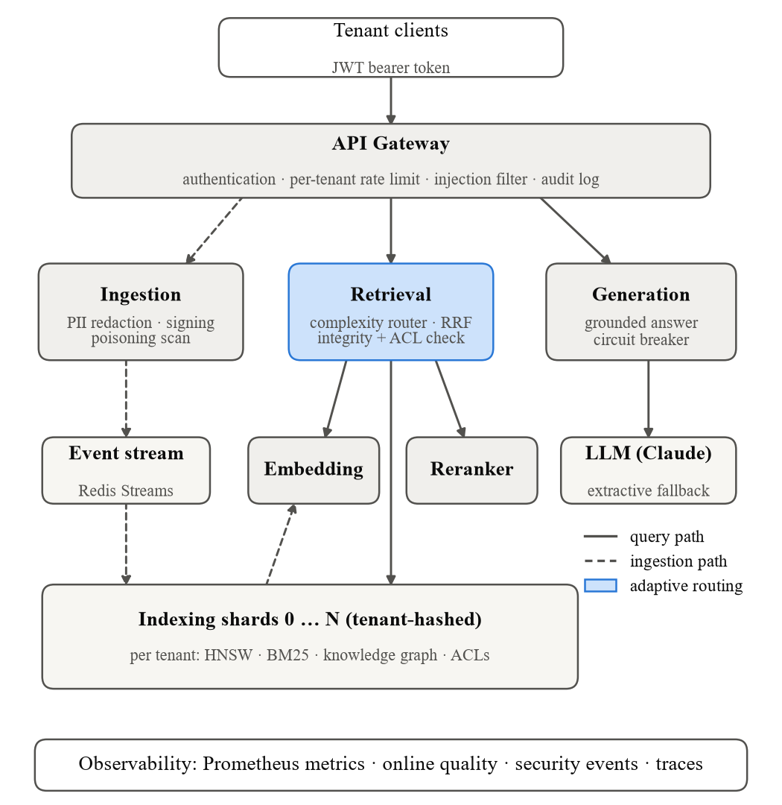
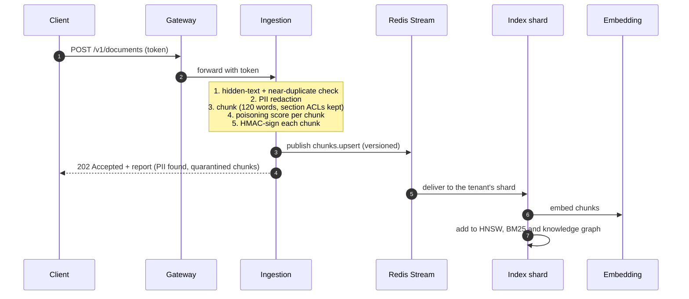
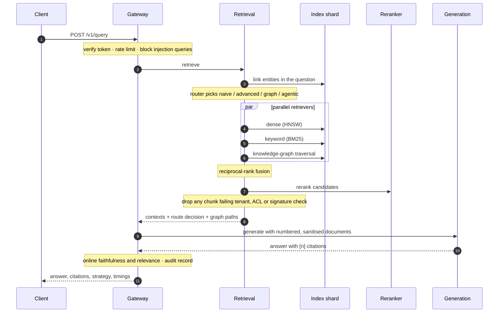
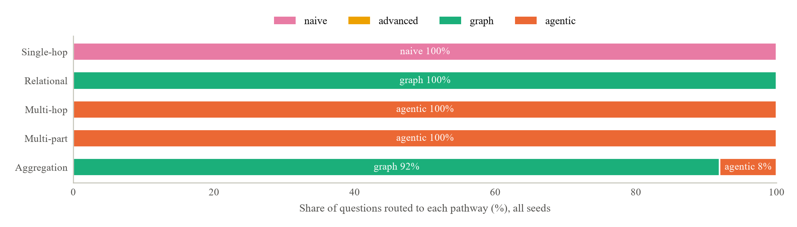
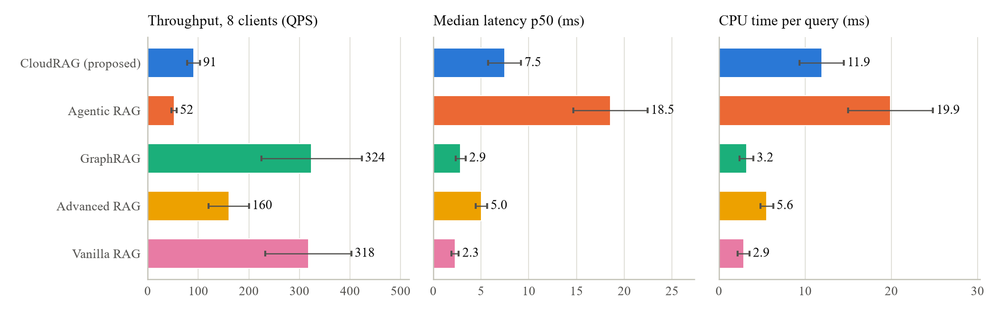
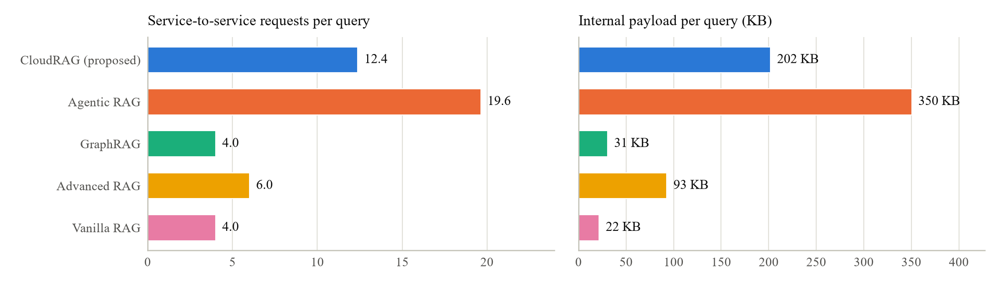
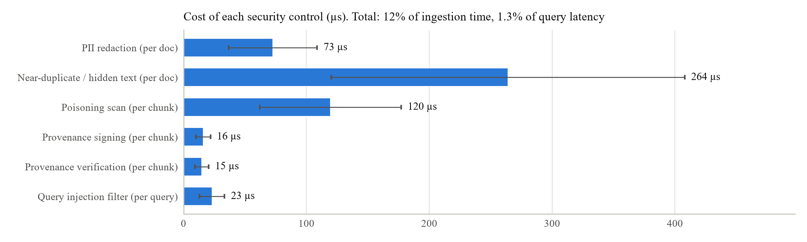

# CloudRAG

**A cloud-native, microservices-based retrieval-augmented generation (RAG) platform for scalable,
secure, multi-tenant enterprise knowledge systems.**

CloudRAG answers questions over a company's private documents. It is split into seven
independently scalable services on Kubernetes. A router sends each question down the cheapest
retrieval pathway that can answer it, and every tenant's data stays isolated and protected end to end.

> **Headline result** (5 independent runs, mean ± std): **96.7 ± 1.1 % answer accuracy**, against
> 92.7 % for the best baseline (agentic RAG), at **2.5× lower median latency** and **1.7× higher
> throughput**. Zero cross-tenant or role-based leaks across 120 leakage probes, and 0 successful poisoning attacks.

<p align="center"></p>

Manipal Institute of Technology research project by Aaryan Sanjay Paranjape, Aryan Chandra,
S. Badri Narayana and Saish Hitesh Thakur.

---

## Contents

1. [The problem](#1-the-problem)
2. [Architecture](#2-architecture)
3. [How it works](#3-how-it-works)
4. [Results](#4-results)
5. [Getting started](#5-getting-started)
6. [Deployment](#6-deployment)
7. [Reproducing the experiments](#7-reproducing-the-experiments)
8. [Configuration](#8-configuration)
9. [Project structure](#9-project-structure)
10. [Limitations](#10-limitations)

---

## 1. The problem

Large language models hallucinate, go stale, and cannot see private data. Retrieval-augmented
generation fixes this by retrieving evidence first and answering from it. In an enterprise,
four more requirements appear:

| Requirement | Why simple RAG falls short | What CloudRAG does |
|---|---|---|
| **Scale** | one monolithic pipeline scales as a single unit | 7 services, each autoscaled; indexes sharded by tenant |
| **Question complexity** | one fixed pipeline is either too weak for multi-hop questions or too slow for simple ones | a router picks naive, advanced, graph or agentic retrieval per question |
| **Security** | shared indexes leak across tenants and roles; documents can be poisoned | per-tenant namespaces, chunk-level RBAC, PII redaction, signed provenance, poisoning quarantine |
| **Operations** | quality, latency, cost and security are measured separately, if at all | one metrics and evaluation harness covers all of them |

The project implements the six objectives of the research proposal:

| # | Objective | Implementation |
|---|---|---|
| 1 | Kubernetes microservice architecture | [`cloudrag/services`](cloudrag/services), [`deploy/k8s`](deploy/k8s) |
| 2 | Query-complexity-aware router | [`cloudrag/retrieval/router.py`](cloudrag/retrieval/router.py) |
| 3 | Hybrid dense + BM25 + knowledge-graph retrieval with fusion and reranking | [`cloudrag/indexing`](cloudrag/indexing), [`cloudrag/retrieval`](cloudrag/retrieval), [`cloudrag/reranking`](cloudrag/reranking) |
| 4 | Tenant-scoped security controls | [`cloudrag/security`](cloudrag/security), [`cloudrag/ingestion`](cloudrag/ingestion) |
| 5 | Observability and evaluation harness | [`cloudrag/observability`](cloudrag/observability), [`cloudrag/evaluation`](cloudrag/evaluation) |
| 6 | Comparison against vanilla, advanced, GraphRAG and agentic RAG | [`paper/`](paper), [Results](#4-results) |

---

## 2. Architecture

<p align="center"></p>

| Service | Port | Role | Scales by |
|---|---|---|---|
| **gateway** | 8000 | public API: JWT auth, per-tenant rate limit, injection filter, orchestration, audit log | HPA on CPU |
| **ingestion** | 8001 | PII redaction, poisoning scan, ACL-aware chunking, provenance signing; publishes events | HPA on CPU |
| **embedding** | 8002 | text → vectors (stateless model server) | HPA on CPU |
| **indexing** | 8003 | per-tenant HNSW + BM25 + knowledge graph; consumes events; serves search | StatefulSet, one shard per pod |
| **retrieval** | 8004 | router + four strategies, rank fusion, integrity and ACL re-check | HPA on CPU |
| **reranker** | 8005 | second-stage relevance scoring | HPA on CPU |
| **generation** | 8006 | grounded answer with citations (Claude, or offline extractive) | HPA on CPU |

Four design decisions run through the whole system:

- **Event-driven ingestion.** Uploads return as soon as an event is on the Redis Stream; index
  shards consume it in the background, so write bursts never slow down queries.
- **Tenant sharding.** Each tenant hashes (SHA-256) to one index shard and gets physically separate
  indexes there.
- **Zero-trust hops.** The user's token travels with every internal call and each service checks it
  again. A shard takes the tenant from the verified token, never from the request.
- **Same code, two modes.** Everything can run in one process (development, tests, experiments) or
  as separate services over HTTP. The calling code is identical in both.

---

## 3. How it works

### 3.1 Ingestion: from document to index



What each security step does:

| Step | Detail |
|---|---|
| PII redaction | email, phone, card (Luhn-checked), SSN, Aadhaar, PAN, IBAN, IP → `[EMAIL]` etc., or keyed pseudonyms |
| Section ACLs | `[[acl roles=finance clearance=2]] … [[/acl]]` restricts part of a document; chunks never cross a section boundary |
| Poisoning score | instruction-override phrases, role or markup injection, invisible Unicode, keyword stuffing, near-duplicate floods, combined into one risk score. ≥ 0.70 is quarantined; ≥ 0.35 is indexed with lower trust |
| Source trust | ad-hoc uploads (`upload://`) are trusted less than systems of record, so a conflicting fact from a system of record wins |
| Provenance | HMAC over tenant, doc, chunk, content hash, ACL, source and trust. Any later tampering is detected |

### 3.2 Query: from question to cited answer



### 3.3 The router

The router reads cheap features of the question: length, linked entities, relation words such as
"supplies" or "used by", aggregation cues such as "which projects", and multi-part structure.
It then picks the cheapest pathway expected to answer the question:

| Pathway | What it does | Typical question |
|---|---|---|
| **naive** | dense top-k | "What is the warranty of the ZX-200 Sensor?" |
| **advanced** | dense + BM25 → RRF → rerank | descriptive, keyword-heavy questions |
| **graph** | + relation-aware knowledge-graph walk (+ community search for aggregation) | "Which vendor supplies the product used by Project Aurora?" |
| **agentic** | decompose → retrieve per sub-question → check coverage → bridge through new entities (≤ 3 hops) | "In which city is the vendor that supplies the product used by Project Aurora headquartered?" |

If the caller sets `latency_budget_ms`, the router uses live p95 latencies to step down
(agentic → graph → advanced → naive) until the budget fits. On the evaluation set it routed
every question type as intended:

<p align="center"></p>

### 3.4 Retrieval engine

| Component | Method | Key parameters |
|---|---|---|
| Dense index | HNSW graph (multi-layer greedy search, neighbour-selection heuristic); exact search fallback for very selective ACL filters | M = 16, ef<sub>c</sub> = 80, ef<sub>s</sub> = 64 |
| Keyword index | incremental Okapi BM25 | k<sub>1</sub> = 1.2, b = 0.75 |
| Knowledge graph | entities and relations extracted at ingestion; relation-aware 2-hop traversal; label-propagation communities | decay 0.5 per hop |
| Fusion | reciprocal-rank fusion: score(d) = Σ w<sub>r</sub> / (60 + rank<sub>r</sub>(d)) | graph weight 1.3 |
| Reranker | query–chunk interaction score: weighted term coverage, best-sentence coverage, bigram matches, scaled by chunk trust | pluggable cross-encoder |

ACLs are applied **during** search, not after it, so restricted chunks never take ranking slots
or leak through scores.

### 3.5 Security model

| Threat | Control | Where |
|---|---|---|
| Tenant A reads tenant B | separate index namespaces; tenant taken from the verified token; re-checked before generation | indexing, retrieval |
| Employee reads finance-only text | document and section ACLs enforced inside search | indexing |
| PII stored in the index | redaction before chunking; answers re-scanned | ingestion, generation |
| Poisoned or injected documents | risk scoring, quarantine, lower trust, sentence sanitisation before the LLM | ingestion, generation |
| Malicious questions | injection and exfiltration filter returns HTTP 422 | gateway |
| Index tampering | HMAC provenance verified on every retrieved chunk | retrieval |
| Covering tracks | hash-chained audit log; `GET /v1/security/audit/verify` | gateway, ingestion |
| A noisy tenant | per-tenant token-bucket rate limit (HTTP 429) | gateway |
| A failed dependency | circuit breakers; failures surface as fast HTTP 503s without retry amplification | HTTP clients |

### 3.6 Observability

Every service exposes `/metrics` (Prometheus), `/healthz` and `/readyz`. The metrics cover:
- request rate and latency;
- router decisions;
- online faithfulness and relevance estimates;
- security events;
- PII redactions;
- LLM tokens and cost;
- event-bus outcomes.

Alert rules ([`deploy/observability/alerts.yml`](deploy/observability/alerts.yml)) fire on latency,
falling faithfulness, integrity violations, poisoning spikes, dead letters and LLM spend.

---

## 4. Results

**Setup.** 5 independent synthetic corpora (seeds 7, 11, 23, 42, 2026). Each has 3 tenants,
768 documents and 69 questions across five types. Every system shares the same ingestion, index
and generator, so differences come from retrieval alone. Hardware: Intel Core i3-1215U (6 cores,
8 threads), 7.7 GB RAM, Windows 11, Python 3.14. Full tables, raw data and LaTeX are in
[`paper/`](paper).

### 4.1 Comparison with existing methods

| Method | Accuracy (%) | Latency p50 (ms) | Throughput (QPS) | F1 | CPU (ms/query) | Energy (J/query)* |
|---|---|---|---|---|---|---|
| Vanilla RAG | 54.1 ± 1.1 | 2.3 ± 0.4 | 318 ± 85 | 0.337 | 2.9 | 0.007 |
| Advanced RAG | 54.5 ± 1.5 | 5.0 ± 0.6 | 160 ± 40 | 0.347 | 5.6 | 0.014 |
| GraphRAG | 68.8 ± 3.0 | 2.9 ± 0.5 | 324 ± 99 | 0.401 | 3.2 | 0.008 |
| Agentic RAG | 92.7 ± 1.6 | 18.5 ± 3.9 | 52 ± 5 | 0.478 | 19.9 | 0.050 |
| **CloudRAG** | **96.7 ± 1.1** | **7.5 ± 1.7** | **91 ± 12** | **0.493** | **11.9** | **0.030** |

<sub>*Energy is estimated from CPU time (2.5 W per busy core), not metered. F1 is retrieval F1
(precision@5 and recall over gold evidence documents); with 1–3 gold documents among 5 retrieved, every
system's F1 is capped well below 1.</sub>

<p align="center"></p>

### 4.2 Where each method fails

| Method | Single-hop | Relational | Multi-hop | Multi-part | Aggregation |
|---|---|---|---|---|---|
| Vanilla RAG | 100.0 | 0.0 | 0.0 | 100.0 | 6.6 |
| Advanced RAG | 100.0 | 3.3 | 0.0 | 100.0 | 4.4 |
| GraphRAG | 93.3 | 98.3 | 8.3 | 90.0 | 4.9 |
| Agentic RAG | 100.0 | 100.0 | 100.0 | 100.0 | 31.1 |
| **CloudRAG** | **100.0** | **100.0** | **100.0** | **100.0** | **69.4** |

- **Single-hop and multi-part** questions are easy for everyone.
- **Relational** questions need the knowledge graph; vanilla and advanced RAG fail them.
- **Multi-hop** chains need iterative bridging, which only the agentic pathway does.
- **Aggregation** ("which projects use products from X?") is the hardest. CloudRAG leads (69% vs 31%)
  because the router widens the context budget for this type.

CloudRAG matches the best method on every type while paying the agentic cost only on the questions
that need it.

### 4.3 Communication overhead

Measured with every service running as its own HTTP app and two index shards:

<p align="center"></p>

Ingestion costs 2 internal requests and 6.1 KB per document, plus 1.2 KB on the event stream.
CloudRAG makes 37% fewer internal calls and moves 42% fewer bytes than always-agentic retrieval.

### 4.4 Security evaluation

| Test | Volume | Result |
|---|---|---|
| Cross-tenant leakage | 60 probes | **0 %** |
| RBAC leakage (unauthorised readers) | 60 probes | **0 %** |
| RBAC recall (authorised readers) | 60 probes | 100 % |
| PII left in the index | 480 seeded values | **0 %** |
| Injection queries blocked | 25 queries | **100 %** |
| Benign queries wrongly blocked | 25 queries | 0 % |
| Instruction-injection documents | 45 | 45 quarantined, 0 attacks succeeded |
| Keyword-stuffing documents | 45 | 45 flagged, 0 attacks succeeded |
| Plain misinformation documents | 45 | 45 accepted (not detectable), 0 attacks succeeded via source trust |
| Audit chain integrity | 11,095 records | valid |

<p align="center"></p>

All security controls together cost **12 % of ingestion time** and **1.3 % of query latency**.

### 4.5 Distributed deployment and fault tolerance

On Docker Compose (Redis + 7 services + 2 index shards):

- **Correctness:** 1.000 / 0.976 accuracy for the two tenants, which landed on different shards.
- **SIGKILL of a shard:** no data lost. Documents that existed only in memory were replayed from the
  Redis stream (114 → 114 chunks).
- **Outage isolation:** only the dead shard's tenant is affected, with clear HTTP 503s (≈ 5 ms once the
  circuit breaker opens). Service resumes about 7 s after restart.
- **Throughput** on one laptop: 12–17 QPS with one replica per service, bounded by the 8-CPU machine.

---

## 5. Getting started

**Requirements:** Python 3.10+. Docker is only needed for the distributed stack.

```bash
pip install -e ".[all]"
```

```bash
python -m pytest
```

Start everything in one process on port 8000:

```bash
python -m cloudrag serve all
```

Open **http://localhost:8000/docs** for interactive API docs.

### Try it (PowerShell)

```powershell
$B = "http://localhost:8000"
$tok = (Invoke-RestMethod "$B/v1/auth/token" -Method Post -ContentType "application/json" -Headers @{"x-admin-key"="dev-admin-key"} -Body '{"tenant_id":"acme","user_id":"alice","roles":["ingest","employee"]}').access_token
$H = @{Authorization = "Bearer $tok"}

Invoke-RestMethod "$B/v1/documents" -Method Post -Headers $H -ContentType "application/json" -Body '{"doc_id":"zx200","title":"Product sheet","source":"plm://products","text":"The ZX-200 Sensor is supplied by Northwind Components. The ZX-200 Sensor carries a warranty period of 18 months."}'

$r = Invoke-RestMethod "$B/v1/query" -Method Post -Headers $H -ContentType "application/json" -Body '{"query":"What is the warranty period of the ZX-200 Sensor?"}'
$r.answer; $r.strategy; $r.route.reasons
```

### Try it (bash)

```bash
TOKEN=$(curl -s localhost:8000/v1/auth/token -H "x-admin-key: dev-admin-key" -H "content-type: application/json" -d '{"tenant_id":"acme","user_id":"alice","roles":["ingest","employee"]}' | python -c "import sys,json;print(json.load(sys.stdin)['access_token'])")
```

```bash
curl -s localhost:8000/v1/query -H "authorization: Bearer $TOKEN" -H "content-type: application/json" -d '{"query":"What is the warranty period of the ZX-200 Sensor?"}'
```

### API

| Method | Path | Purpose | Role |
|---|---|---|---|
| POST | `/v1/auth/token` | development token (needs `x-admin-key`) | – |
| POST | `/v1/documents` · `/v1/documents:batch` | ingest | `ingest` |
| GET / DELETE | `/v1/documents/{id}` | status / delete | any / `ingest` |
| POST | `/v1/query` | retrieve + answer | any |
| POST | `/v1/retrieve` | retrieval only | any |
| GET | `/v1/stats` | tenant index statistics | any |
| GET | `/v1/security/quarantine` | quarantined chunks | `security` |
| GET | `/v1/security/audit/verify` | verify the audit chain | `security` |
| GET | `/metrics` · `/healthz` · `/readyz` | operations | – |

### Using Claude for answers

The default generator assembles answers from the retrieved sentences, so no API key is needed. To
generate with Claude (model `claude-opus-5-5`), set `CLOUDRAG_LLM=anthropic` and `ANTHROPIC_API_KEY`.
Requests use server-side refusal fallbacks, every answer reports its token cost, and a circuit
breaker falls back to the offline generator if the API is unavailable.

---

## 6. Deployment

**Docker Compose** runs Redis, the seven services and two index shards:

```bash
docker compose up --build -d
```

```bash
docker compose down
```

Add `--profile observability` to `up` for Prometheus on :9090.

**Kubernetes** ([`deploy/k8s`](deploy/k8s)):

```bash
kubectl apply -k deploy/k8s/base
```

```bash
kubectl apply -k deploy/k8s/mesh && kubectl apply -k deploy/k8s/monitoring
```

| Layer | Contents |
|---|---|
| `base` | namespace (restricted pod security), ConfigMap/Secret, Redis, 6 Deployments + HPA + PDB, indexing StatefulSet with volumes, default-deny NetworkPolicies, Ingress |
| `mesh` | Istio strict mTLS, identity-based AuthorizationPolicies, circuit breaking and outlier ejection, retries |
| `monitoring` | PodMonitor and PrometheusRule alerts |

Replace the placeholder Secret before deploying. Keep `CLOUDRAG_SHARD_COUNT` equal to the indexing replica count.

---

## 7. Reproducing the experiments

```bash
python -m cloudrag paper --seeds 7,11,23,42,2026 --tenants initech,umbrella,hooli --filler 200 --out paper
```

```bash
python paper/make_figures.py
```

The first command writes `paper/results/` (JSON + Markdown) and `paper/tables/` (IEEE LaTeX tables).
The second renders every chart in `paper/figures/`. For a single quick run:

```bash
python -m cloudrag eval
```

[`paper/README.md`](paper/README.md) maps each output to the IEEE template sections and defines every metric.

---

## 8. Configuration

Every field in [`cloudrag/config.py`](cloudrag/config.py) can be set as `CLOUDRAG_<FIELD>`:

| Setting | Default | Purpose |
|---|---|---|
| `SECRET_KEY`, `PROVENANCE_KEY`, `ADMIN_BOOTSTRAP_KEY` | dev values | **change these** |
| `DEV_AUTH` | `true` | enable `/v1/auth/token`; turn off when an IdP issues tokens |
| `LLM` | `extractive` | `anthropic` to use Claude |
| `EMBEDDER` | `hashing` | or `sentence-transformers:<model>` (set `EMBED_DIM` to match) |
| `RERANKER` | `lexical` | or `cross-encoder:<model>` |
| `VECTOR_INDEX` | `hnsw` | or `flat` |
| `BUS` / `REDIS_URL` | `memory` | `redis` in distributed mode |
| `SHARD_COUNT` / `INDEXING_URLS` | `1` / – | index sharding |
| `PII_MODE` | `redact` | `pseudonymize` or `off` |
| `SOURCE_TRUST` | `upload://=0.6,…` | trust ceiling per source prefix |
| `POISON_QUARANTINE_THRESHOLD` / `POISON_FLAG_THRESHOLD` | 0.70 / 0.35 | poisoning actions |
| `QUERY_BLOCK_THRESHOLD` | 0.80 | injection filter |
| `RATE_LIMIT_RPS` / `RATE_LIMIT_BURST` | 50 / 100 | per-tenant limits |

---

## 9. Project structure

```
cloudrag/
  core/            data contracts, tokenisation, entity & relation extraction
  security/        auth & rate limits, PII, provenance, poisoning, query guard, audit log
  ingestion/       ACL-aware chunker, ingestion pipeline
  embedding/       embedders + embedding service
  indexing/        HNSW / flat index, BM25, knowledge graph, tenant store, indexing service
  retrieval/       router, reciprocal-rank fusion, retrieval strategies
  reranking/       rerankers
  generation/      extractive + Claude generators, prompts, cost accounting
  messaging/       in-memory and Redis Streams event bus
  clients/         HTTP clients, circuit breaker, retries
  observability/   Prometheus metrics
  evaluation/      metrics, synthetic corpus, harness, overhead, paper experiments
  services/        FastAPI app per microservice
  gateway.py       public API orchestration
  runtime.py       local vs distributed wiring
  cli.py           serve · token · eval · paper · loadtest
deploy/            Kubernetes (base, mesh, monitoring) and Prometheus config
paper/             figures, LaTeX tables, results for the IEEE paper
reports/           single-run evaluation reports (dev and held-out)
tests/             47 tests: unit, security, end-to-end, HTTP topology, event bus
```

---

## 10. Limitations

- **Synthetic data.** The corpus has known answers so accuracy can be measured exactly, but it was
  also used while developing the router and generator. Expect lower numbers on real enterprise text;
  evaluating on a public benchmark (e.g. the TREC RAG track) is future work.
- **Scale.** About 800 documents per run on one laptop, not the 1M–10M documents and 100–1,000
  concurrent queries in the proposal. That needs a cluster and a compiled ANN index (the HNSW here is
  pure Python/NumPy).
- **Lexical defaults.** The default embedder and reranker match words, not meaning. Semantic models can
  be plugged in through configuration but were not evaluated.
- **Generator.** The headline numbers use the offline extractive generator. Faithfulness ≈ 1.0 is a
  property of that generator, and Claude-generated answers were not benchmarked.
- **Poisoning.** A false statement with no injection signal is not detected. It only loses because
  uploads carry less trust than systems of record, so the same claim from a trusted source would win.
- **Hot tenants.** All of one tenant's searches hit one index shard. Read replicas per shard are not
  implemented.
- **Kubernetes** manifests render and the same image runs under Docker Compose, but no live cluster
  deployment was performed.

---

## License

[MIT](LICENSE)
